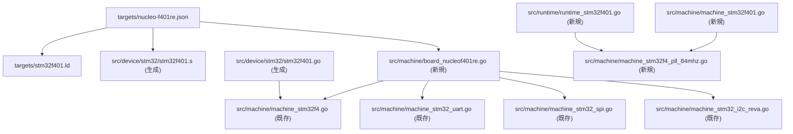

# NUCLEO-F401RE TinyGo 追加 実装プラン

## 調査で確定した事実

### 流用できる既存実装（変更不要）

- [`src/machine/machine_stm32f4.go`](src/machine/machine_stm32f4.go) — build: `stm32f4`、GPIO/AF定数/Flash/EXTI等すべて流用可
- [`src/machine/machine_stm32_uart.go`](src/machine/machine_stm32_uart.go) — build: `stm32`、流用可
- [`src/machine/machine_stm32_spi.go`](src/machine/machine_stm32_spi.go) — build: `stm32 && !stm32f7x2 && ...`、流用可
- [`src/machine/machine_stm32_i2c_reva.go`](src/machine/machine_stm32_i2c_reva.go) — build: `stm32f4 || stm32f1`、流用可
- [`src/machine/machine_stm32f4_otgfs_vbus.go`](src/machine/machine_stm32f4_otgfs_vbus.go) — build tag に `stm32f401` が**既に含まれている**

### F401 と F405/F407 の主な相違点

| 項目 | F405/F407 | F401RE |
| --- | --- | --- |
| 最大 SYSCLK | 168 MHz | **84 MHz** |
| Flash | 1 MB | **512 KB** |
| SRAM | 128 KB | **96 KB** |
| CCM RAM | あり | **なし** |
| Flash wait (84MHz) | — | **2 WS** |
| APB1 分周 | HCLK/4 (42MHz) | **HCLK/2 (42MHz)** |
| APB2 分周 | HCLK/2 (84MHz) | **HCLK/1 (84MHz)** |
| APB1 timer clock | 42×2=84MHz | **42×2=84MHz** |
| APB2 timer clock | 84×2=168MHz | **84×1=84MHz** |

---

## 新規作成ファイル（6+2ファイル）

### 1. `targets/stm32f401.ld`

F405/F407 linker script のサイズのみ変更。

```
FLASH_TEXT : ORIGIN = 0x08000000, LENGTH = 512K
RAM        : ORIGIN = 0x20000000, LENGTH = 96K
_stack_size = 4K;
INCLUDE "targets/arm.ld"
```

参考: [`targets/stm32f405.ld`](targets/stm32f405.ld)

---

### 2. `targets/nucleo-f401re.json`

```json
{
    "inherits": ["cortex-m4"],
    "build-tags": ["nucleof401re", "stm32f401", "stm32f4", "stm32"],
    "serial": "uart",
    "linkerscript": "targets/stm32f401.ld",
    "extra-files": ["src/device/stm32/stm32f401.s"],
    "flash-method": "openocd",
    "openocd-interface": "stlink-v2-1",
    "openocd-target": "stm32f4x"
}
```

参考: [`targets/nucleo-f103rb.json`](targets/nucleo-f103rb.json), [`targets/stm32f4disco.json`](targets/stm32f4disco.json)

---

### 3. `src/runtime/runtime_stm32f401.go`

[`src/runtime/runtime_stm32f405.go`](src/runtime/runtime_stm32f405.go) の構造を流用し、以下を変更:

- build tag: `//go:build stm32f401`
- `HCLK_FREQ_HZ = 84_000_000`
- `PCLK1_FREQ_HZ = HCLK/2 = 42_000_000`
- `PCLK2_FREQ_HZ = HCLK/1 = 84_000_000`
- `RCC_DIV_PCLK1 = stm32.RCC_CFGR_PPRE1_Div2`
- `RCC_DIV_PCLK2 = stm32.RCC_CFGR_PPRE2_Div1`
- `FLASH_LATENCY = 2` (2 WS、64〜90 MHz)
- `CLK_CCM_RAM` の定義と `initCLK()` 内の CCM 有効化を**削除**
- `initOSC()` 内の PLL を `machine.PLLParams84MHz()` に変更
- `PWR_SCALE1`: F401 の VOS=Scale1（最大 84MHz）に対応する値（SVD 生成後に確認）

---

### 4. `src/machine/machine_stm32f401.go`

[`src/machine/machine_stm32f40x.go`](src/machine/machine_stm32f40x.go) に相当する F401 固有 machine ファイル。

- build tag: `//go:build stm32f4 && stm32f401`
- `CPUFrequency()`: `PLLParams84MHz()` を使って算出
- `APB1_TIM_FREQ = 84_000_000` (APB1=42MHz、prescaler=2 → timer=84MHz)
- `APB2_TIM_FREQ = 84_000_000` (APB2=84MHz、prescaler=1 → timer=84MHz)

---

### 5. `src/machine/machine_stm32f4_pll_84mhz.go`

[`src/machine/machine_stm32f4_pll_168mhz.go`](src/machine/machine_stm32f4_pll_168mhz.go) に相当する F401 用 PLL パラメータ。

- build tag: `//go:build stm32f4 && stm32f401`
- `PLLParams84MHz()`: VCO=336MHz、P=4 → SYSCLK=84MHz、Q=7 → USB=48MHz

```go
func PLLParams84MHz() PLLParams {
    switch xtalHz {
    case 8_000_000:
        return PLLParams{M: 4, N: 168, P: 4, Q: 7}
    case 16_000_000:
        return PLLParams{M: 8, N: 168, P: 4, Q: 7}
    default:
        panic("unsupported xtal frequency")
    }
}
```

---

### 6. `src/machine/board_nucleof401re.go`

[`src/machine/board_nucleol476rg.go`](src/machine/board_nucleol476rg.go) を主な参考に作成（Nucleo-64 ピン配置が同一）。

- build tag: `//go:build nucleof401re`
- `xtalHz = 8_000_000`
- `LED_GREEN = PA5` (Nucleo-64 LD2、Arduino D13)
- `BUTTON = PC13` (B1 USER、active low)
- UART: USART2、`PA2` (TX)、`PA3` (RX)、`AF7_USART1_2_3`
- I2C0/I2C1: I2C1、SCL=`PB8`、SDA=`PB9`、`AF4_I2C1_2_3`
- SPI0/SPI1: SPI1、SCK=`PA5`、SDI=`PA6`、SDO=`PA7`、`AF5_SPI1_SPI2`
- Arduino ヘッダ: D0=PA3、D1=PA2、...D13=PA5、D14=PB9、D15=PB8、A0=PA0〜A5=PC0

---

### 7 & 8. `src/device/stm32/stm32f401.go` & `stm32f401.s`（生成）

`lib/stm32-svd/svd/stm32f401.svd` は既に存在するため、以下で生成可能:

```bash
make gen-device-stm32
```

生成後にリポジトリへ追加してコミットする（F405/F407 の `.go`/`.s` と同様）。

---

## アーキテクチャ概略



---

## 実装順序

1. device 生成 (`make gen-device-stm32`) → `stm32f401.go` / `stm32f401.s` を確認・コミット対象に追加
2. `targets/stm32f401.ld` 作成
3. `targets/nucleo-f401re.json` 作成
4. `src/machine/machine_stm32f4_pll_84mhz.go` 作成
5. `src/machine/machine_stm32f401.go` 作成
6. `src/runtime/runtime_stm32f401.go` 作成 (PWR_SCALE 値を SVD 生成後に確認)
7. `src/machine/board_nucleof401re.go` 作成
8. `tinygo build -target=nucleo-f401re examples/blinky1` でビルド確認

---

## 既存ファイルへの追加変更（ビルド修正フェーズで判明）

STM32F401 は STM32F405/F407 と比較してペリフェラル数が大幅に少ないため、
`stm32f4` build tag が付いた既存の共通ファイル群が F401 非対応のシンボルを参照し、
コンパイルエラーが発生した。以下の追加対応が必要であった。

### 根本原因

| カテゴリ | F401 に存在しないもの |
| --- | --- |
| GPIO ポート | GPIOF / GPIOG / GPIOI / GPIOJ / GPIOK |
| タイマ | TIM6 / TIM7 / TIM8 / TIM12 / TIM13 / TIM14 |
| UART | UART4 / UART5 / USART3 |
| ADC | ADC2 / ADC3、`ADC_SMPR1_SMP11_Cycles84` などの named 定数 |
| その他 | DAC / CAN1 / CAN2 / RNG |
| OTG FS | SVD 生成後のレジスタ名が F405/F407 と異なる |

### 新規作成ファイル（追加）

| ファイル | build tag | 役割 |
| --- | --- | --- |
| `src/machine/machine_stm32f4_extended.go` | `stm32f4 && !stm32f401` | `machine_stm32f4.go` から F401 非対応な関数・変数を抽出して F405/F407/F469 向けに保持（`getPort()`・`enableAltFuncClock()`・TIM6〜14・`registerUPInterrupt()`・`registerOCInterrupt()`・`initRNG()`・`getBaudRateDivisor()`） |
| `src/machine/machine_stm32f401_periph.go` | `stm32f401` | 上記各関数の F401 対応版（存在するペリフェラルのみ使用、APB クロック分周比も F401 に合わせて修正） |
| `src/machine/machine_stm32f401_adc.go` | `stm32f401` | F401 用 ADC 実装。F401 SVD は `Cycles84` named 定数がないため数値 `4` を直接使用 |

### 既存ファイルのビルドタグ修正

| ファイル | 変更内容 |
| --- | --- |
| `src/machine/machine_stm32f4.go` | F401 非対応な関数・変数を `machine_stm32f4_extended.go` へ移動し削除 |
| `src/machine/machine_stm32_adc_f4.go` | `stm32f4` → `stm32f4 && !stm32f401`（ADC named 定数不一致のため除外） |
| `src/machine/machine_stm32_otgfs_usb.go` | `stm32f4 \|\| stm32f7` → `(stm32f4 && !stm32f401) \|\| stm32f7`（OTG FS レジスタ構造差異のため除外） |
| `src/machine/machine_stm32f4_otgfs_vbus.go` | build tag から `stm32f401` を除外（`GCCFG_NOVBUSSENS` が F401 SVD に存在しないため） |
| `src/machine/machine_stm32_rng.go` | 除外リストに `stm32f401` を追加（F401 は RNG ペリフェラルなし） |
| `src/machine/usb.go` | `stm32f4` → `stm32f4 && !stm32f401`（USB 実装シンボルが OTG FS ドライバ経由で提供されるため） |
| `src/runtime/rand_hwrng.go` | 除外リストに `stm32f401` を追加（HW RNG なし） |
| `src/runtime/rand_norng.go` | `rand_hwrng.go` と対称的に `stm32f401` を除外リストへ追加 |
| `src/crypto/rand/rand_baremetal.go` | 同様に `stm32f401` を除外リストへ追加 |

### 備考

- OTG FS USB は今回のスコープ外（SVD のレジスタ名不一致が残課題）。F401 でも USB を有効にするには F401 SVD の OTG FS 構造に合わせた専用ドライバが必要。
- SPI の `getBaudRate()` における APB クロック分周比（F405/F407 前提の `/2`、`/4`）は blinky1 では問題なし。正しい値（`/1`、`/2`）への修正は SPI 動作確認フェーズで対応する。

---

## examples への追加変更（通信テスト・アナログ対応フェーズで判明）

### 新規作成 example ファイル

| ファイル | 対象ボード | 役割 |
|---|---|---|
| `src/examples/uart-peer-test/main.go` | nucleo-f401re | UART2 (PA9/PA10) でペアボードへ `hello` 送信し、ST-Link VCP に送受信内容を表示 |
| `src/examples/uart-hw-echo/main.go` | xiao-rp2040 | UART0 (D6/D7) で受信バイトをそのまま折り返す（UART ピアテスト対向用） |
| `src/examples/i2c-master-test/main.go` | nucleo-f401re | I2C0 (PB8/PB9) でアドレス 0x11 のターゲットに読み書きし、結果を VCP 出力 |
| `src/examples/i2c-slave-test/main.go` | xiao-rp2040 | I2C1 (D5/D4) をアドレス 0x11 で Listen し、256byte メモリマップを実装 |
| `src/examples/spi-loopback-test/main.go` | nucleo-f401re | SPI0 (PA5/PA6/PA7) でループバックテスト（MOSI-MISO ジャンパ直結）、結果を VCP 出力 |
| `src/examples/pwm/nucleo-f401re.go` | nucleof401re | PWM example のボード設定（TIM2・D6/D3 ピン定義） |
| `src/examples/adc/adc_nucleof401re.go` | nucleof401re | ADC example のボード設定（`sensor = ADC{Pin: A0}`） |
| `src/examples/adc/adc_default.go` | !nucleof401re | ADC example のデフォルト設定（`sensor = ADC{Pin: ADC2}`） |

### 既存 example ファイルの変更

| ファイル | 変更内容 |
|---|---|
| `src/examples/uart/uart.go` | `sensor` をパッケージレベル変数に昇格させ `main()` のみ残す（ボード別ファイルに分離） |
| `src/examples/uart/uart_xiao_rp2040.go`（新規） | `//go:build xiao_rp2040`：`uart=UART0`, `tx=UART0_TX_PIN`, `rx=UART0_RX_PIN` |
| `src/examples/uart/uart_default.go`（新規） | `//go:build !xiao_rp2040`：`uart=UART1`, `tx=UART1_TX_PIN`, `rx=UART1_RX_PIN` |
| `src/examples/adc/adc.go` | `sensor` をパッケージレベル変数に昇格させ `main()` のみ残す |

### board_nucleof401re.go への UART2 追加

ST-Link VCP（USART2/PA2-PA3）とは別に、外部 UART 通信用として USART1 を UART2 として追加。

| 追加項目 | 値 |
|---|---|
| `UART2_TX_PIN` | `PA9`（Arduino D8） |
| `UART2_RX_PIN` | `PA10`（Arduino D2） |
| `UART2` 変数 | `stm32.USART1`、`AF7_USART1_2_3` |
| `init()` | `UART2.Interrupt = interrupt.New(stm32.IRQ_USART1, _UART2.handleInterrupt)` |

### PWM タイマ選定の理由

`runtime_stm32f401.go` が `initTickTimer(&machine.TIM3)` で **TIM3 をシステムタイマーとして専有**しているため、PWM example で TIM3 を使うとタイマー割り込みが競合して正常な波形が出ない。  
他の F4 ボード（`runtime_stm32f4.go`）は TIM2 を tick に使うため TIM3 が空いているが、F401 では逆になる。

→ PWM example は **TIM2**（F401 では tick に使われていない）を使用する。

```go
//go:build nucleof401re

package main

import "machine"

// TIM3 は runtime tick timer が専有するため TIM2 を使用。
// PB10=D6 (TIM2_CH3/AF1)、PB3=D3 (TIM2_CH2/AF1)
var (
    pwm  = &machine.TIM2
    pinA = machine.D6 // PB10 = TIM2_CH3 (AF1)
    pinB = machine.D3 // PB3  = TIM2_CH2 (AF1)
)
```

---

## テスト計画

### ステップ1: 単体動作確認（対向機不要）

| # | 機能 | 使用プログラム | ピン | 確認方法 | 結果 |
|---|---|---|---|---|---|
| 1 | LED 点滅 | `examples/blinky1` | PA5 (LD2) | 500ms 間隔で点滅することを目視確認 | ✅ 動作確認済み（点滅間隔変更も確認） |
| 2 | UART echo | `examples/echo` / `echo2` | PA2(TX)/PA3(RX) → ST-Link VCP | Tera Term (115200 bps) で文字入力・折り返しを確認（ローカルエコー OFF で確認） | ✅ 動作確認済み |
| 3 | ボタン（ポーリング） | `examples/button` | PC13 (B1 USER) | B1 押下で LED が消灯することを目視確認 | ✅ 動作確認済み |
| 3 | ボタン（割り込み） | `examples/pininterrupt` | PC13 (B1 USER) | B1 押下でLEDがトグルすることを目視確認 | ✅ 動作確認済み（連打時の LED 張り付きは example 側の naive debounce 限界によるもので F401RE 固有の問題ではない） |
| 4 | デバイス ID | `examples/device-id` | — | Tera Term に chip UID が出力されることを確認 | ✅ 動作確認済み |
| 5 | 乱数 | `examples/rand` | — | Tera Term に乱数が出力されることを確認 | ✅ 確認済み（`crypto/rand` は HW RNG 非搭載のため `panic: no rng` → 意図通り。`math/rand` は動作可） |

### ステップ2: xiao-rp2040 との通信確認

対向機: **xiao-rp2040**（TinyGo 標準サポートボード）

#### UART（双方向）

| 項目 | 内容 |
|---|---|
| NUCLEO 側プログラム | `examples/uart-peer-test`（新規作成） |
| xiao 側プログラム | `examples/uart-hw-echo`（新規作成） |
| NUCLEO ピン | PA9(TX/D8) / PA10(RX/D2) = USART1 (UART2) |
| xiao ピン | D6(TX/GPIO0) / D7(RX/GPIO1) = UART0 |
| 接続 | NUCLEO PA9(D8) → xiao D7、NUCLEO PA10(D2) → xiao D6、GND-GND |
| 確認方法 | Tera Term に `sent: hello` / `recv: hello` が繰り返し表示されることを確認 |
| 備考 | xiao の `machine.Serial` = USB CDC のため `echo` example では不可。ハードウェア UART0 を直接使う専用プログラムが必要 |
| 結果 | ✅ 双方向通信確認済み |

#### I2C（NUCLEO=マスター、xiao=ターゲット）

| 項目 | 内容 |
|---|---|
| NUCLEO 側プログラム | `examples/i2c-master-test`（新規作成） |
| xiao 側プログラム | `examples/i2c-slave-test`（新規作成） |
| NUCLEO ピン | PB8(SCL/D15) / PB9(SDA/D14) = I2C1 (I2C0) |
| xiao ピン | D5(SCL/GPIO7) / D4(SDA/GPIO6) = I2C1 |
| 接続 | SCL-SCL、SDA-SDA、GND-GND（外付けプルアップ不要: STM32・RP2040 ともに内部プルアップ自動有効） |
| ターゲットアドレス | 0x11 |
| 確認方法 | Tera Term に `read: Hello NUCLEO!` / `wrote 42 to reg 1` / `readback reg 1: 42` が表示されることを確認 |
| 結果 | ✅ 双方向通信確認済み |

#### SPI（ループバックテスト）

| 項目 | 内容 |
|---|---|
| プログラム | `examples/spi-loopback-test`（新規作成） |
| 接続 | PA7(D11/MOSI) と PA6(D12/MISO) をジャンパ線で直結 |
| 備考 | TinyGo は SPI スレーブモード非対応のため xiao との直接通信不可。ループバックで TX/RX 動作を確認 |
| 確認方法 | Tera Term に `SPI loopback OK: tx==rx` が繰り返し表示されることを確認 |
| 結果 | ✅ 動作確認済み |

### ステップ3: アナログ・PWM 確認

| # | 機能 | 使用プログラム | ピン | 実施した変更 | 結果 |
|---|---|---|---|---|---|
| 9 | ADC | `examples/adc` | A0(PA0) | `adc.go` をパッケージレベル変数に変更、`adc_nucleof401re.go`（A0 使用）・`adc_default.go`（ADC2 使用）を新規作成 | 🔲 未実施 |
| 10 | PWM | `examples/pwm` | D6(PB10)/D3(PB3) | `pwm/nucleo-f401re.go` を新規作成（TIM2 使用、TIM3 は tick timer 専有のため） | 🔲 未実施 |

### 確認順序と結果

```
1.  blinky1          → LED 点滅・再書き込み確認              ✅ 実機確認済み
2.  echo / echo2     → UART (ST-Link VCP) 送受信確認         ✅ 実機確認済み
3.  button           → GPIO 入力（ポーリング）確認            ✅ 実機確認済み
    pininterrupt     → GPIO 入力（割り込み）確認              ✅ 実機確認済み（連打時挙動は example 限界）
4.  device-id        → Chip UID 出力確認                     ✅ 実機確認済み
5.  rand             → 乱数確認                              ✅ 確認済み（crypto/rand 非対応は意図通り）
6.  uart-peer-test   → xiao-rp2040 との UART 双方向通信確認  ✅ 実機確認済み
7.  i2c-master-test  → xiao-rp2040 との I2C 通信確認         ✅ 実機確認済み
8.  spi-loopback     → SPI TX/RX ループバック確認             ✅ 実機確認済み
9.  ADC              → アナログ入力確認                      🔲 未実施
10. PWM              → タイマ出力確認                        🔲 未実施
```

### 残課題（テスト後対応）

- **OTG FS USB**: F401 SVD の OTG FS レジスタ名が F405/F407 と異なるため、現時点では USB ドライバ未対応。F401 SVD に合わせた専用ドライバの実装が必要。
- **SPI クロック分周比の修正**: `getBaudRate()` は F405/F407 前提（`CPUFrequency()/2`・`/4`）のため、F401 では APB2=`/1`・APB1=`/2` に修正が必要。SPI 動作確認フェーズで対応する。

### 対応済み追加変更

- `targets/nucleo-f401re.json`: `openocd-interface` を `stlink-v2-1`（非推奨）→ `stlink` に変更、`openocd-commands` に `reset_config srst_only connect_assert_srst` を追加（実行中ファームウェアがある状態でも RESET ボタン不要で書き込み可能）。
- `src/machine/board_nucleof401re.go`: 外部 UART 通信用に UART2（USART1/PA9-PA10）を追加。ST-Link VCP の UART1（USART2/PA2-PA3）とは独立して使用可能。`init()` に `IRQ_USART1` の割り込みハンドラ登録を追加。

---

## PR スコープ
- STM32F401RE chip support (runtime / PLL / machine / linker / device) の最小実装
- 既存 F405/F407/F469 の実装への変更なし
- 実機確認: LED blink → UART echo の順
